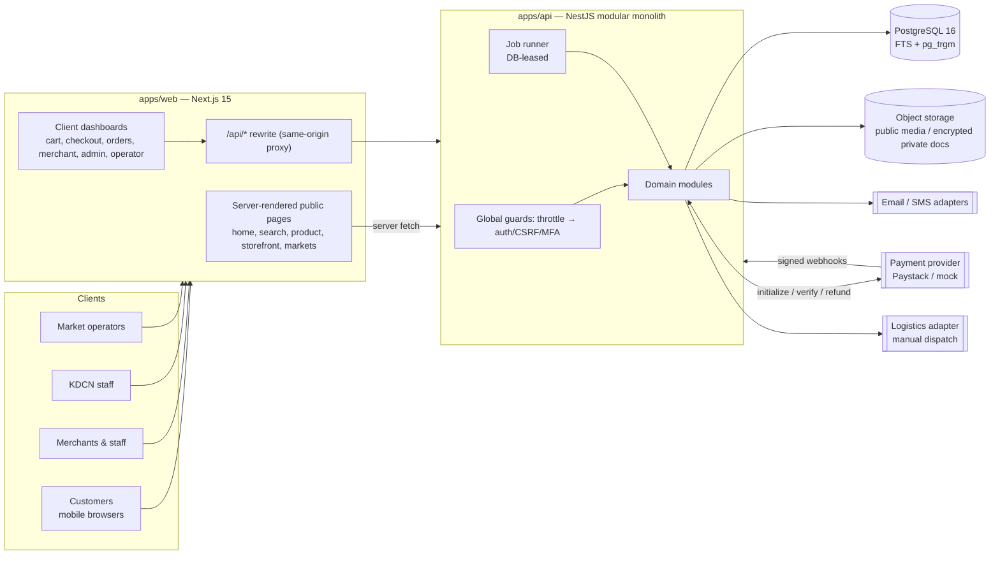
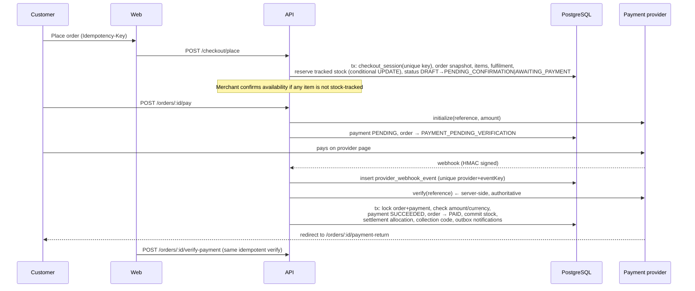

# Architecture

## System overview

* **One deployable API, one database.** Domain boundaries are folders with their own services
  (ADR 0001). Modules talk through injected services, never through each other's tables directly
  except via the shared Prisma client within clearly owned code paths.
* **Same-origin browser access.** The browser only calls `/api/*` on the web origin; Next.js
  rewrites to the API. CORS is not enabled, so cookies stay `SameSite=Lax` and cross-site API calls
  are impossible from browsers (ADR 0003).
* **Public pages are server-rendered** (fast first paint on slow networks, SEO, shareable storefront
  links). Dashboards are client components calling the API.

## Module boundaries (`apps/api/src/modules`)

| Module | Responsibility | Key files |
| --- | --- | --- |
| `auth` + `common/auth` | Registration, sessions (opaque tokens, hashed), staff TOTP MFA, CSRF, role guards, object-level access helpers | `auth.controller.ts`, `auth.guard.ts`, `session.service.ts`, `access.service.ts` |
| `merchants` | Merchant profile, locations (public vs encrypted private), service areas, fulfilment options, affiliations, staff invitations, verification pathways | `merchants.controller.ts`, `merchant-verification.service.ts`, `merchant-public.ts` |
| `markets` | Market operator portal (profile, affiliations, announcements, collection points, aggregate metrics) | `operator.controller.ts` |
| `catalog` | Product identity vs merchant listing, variants, inventory, images, honest availability, public catalogue/storefront/market pages | `merchant-listings.controller.ts`, `public.controller.ts`, `availability.ts` |
| `search` | PostgreSQL FTS + trigram fallback, filters, ranking | `search.service.ts` |
| `cart` | Guest & user carts (multi-merchant capable) | `cart.service.ts` |
| `checkout` | Quotes, idempotent single-merchant order placement, fee/commission snapshot, stock reservation | `checkout.service.ts` |
| `orders` | State machine, compare-and-set transitions, customer/merchant actions, expiry jobs | `order-state-machine.ts`, `order-state.service.ts`, `orders.service.ts`, `inventory.service.ts` |
| `payments` | Provider abstraction, mock + Paystack adapters, verification, webhooks, refunds | `payments.service.ts`, `refunds.service.ts`, `providers/*` |
| `settlements` | Commission rules, per-order settlement allocations | `commission.service.ts`, `settlements.service.ts` |
| `fulfilment` | Fulfilment records, collection codes, dispatch & assignments, logistics adapter | `fulfilment.service.ts`, `logistics.adapter.ts` |
| `disputes` | Disputes, evidence messages, resolution with refunds; verified-purchase reviews | `disputes.service.ts` |
| `notifications` | Transactional outbox, channel adapters (log driver in R1), in-app inbox | `notification.service.ts` |
| `analytics` | First-party events, segment metrics with precise definitions | `analytics.service.ts` |
| `admin` | Staff APIs for verification, moderation, orders, finance, disputes, fulfilment, users, audit | `admin-*.controller.ts` |
| `storage` | Content-sniffed uploads, EXIF stripping, encrypted private bucket | `storage.service.ts`, `file-inspection.ts` |
| `jobs` | Lease-protected background jobs | `jobs.service.ts` |

## Key flows

### Order to payment

### Fulfilment & completion

PAID → (merchant) ACCEPTED_FOR_FULFILMENT → PREPARING →
* collection: READY_FOR_COLLECTION → merchant enters the customer's 6-digit code → DELIVERED → COMPLETED
* delivery: DISPATCHED (assignment recorded) → DELIVERED → customer confirms or auto-completes after
  `AUTO_COMPLETE_DAYS` → COMPLETED. Failed attempts return to PREPARING.

Settlement allocation moves PENDING_FULFILMENT → ELIGIBLE (completed) → SETTLED (payout recorded);
disputes put it ON_HOLD; full refunds REVERSE it.

## Deployment architecture (recommended)

See [DEPLOYMENT.md](DEPLOYMENT.md). Two stateless containers (web, api) behind a TLS-terminating
load balancer, a managed PostgreSQL with PITR backups, managed object storage, and an error/uptime
monitoring service. Jobs run inside API instances with database leases so any number of replicas is
safe.

## Extensibility points

* `PaymentProviderAdapter` — add Flutterwave or another provider without touching orders.
* `LogisticsAdapter` — courier integrations (pickup booking, tracking) behind manual dispatch.
* `ChannelAdapter` — SMTP/transactional email, SMS (e.g. Termii), WhatsApp Business.
* `StorageService` — S3-compatible driver behind the same interface.
* Cart/CheckoutSession/Order already separate merchant groups → multi-merchant checkout (R3).
* Product vs Listing separation → shared catalogue / multiple sellers per product.
* `MerchantSegment` + `Market.branded` → additional branded market experiences.
