# Data model

Schema: [`apps/api/prisma/schema.prisma`](../apps/api/prisma/schema.prisma). Migrations:
`0001_init` (tables), `0002_search_integrity` (FTS triggers, GIN/trigram indexes, CHECK
constraints, append-only triggers, partial unique indexes), `0003_password_reset`.

```mermaid
erDiagram
  USER ||--o{ SESSION : has
  USER ||--o| CUSTOMER_PROFILE : has
  USER ||--o{ MERCHANT_MEMBER : "member of"
  USER ||--o{ MARKET_OPERATOR_MEMBER : operates
  MERCHANT ||--o{ MERCHANT_MEMBER : staff
  MERCHANT ||--o{ MERCHANT_VERIFICATION : verified_by
  MERCHANT_VERIFICATION ||--o{ VERIFICATION_DOCUMENT : evidence
  MERCHANT ||--o{ MERCHANT_LOCATION : "public or private"
  MERCHANT ||--o{ MERCHANT_SERVICE_AREA : delivers_to
  MERCHANT ||--o{ MERCHANT_FULFILMENT_OPTION : offers
  MERCHANT ||--o{ MARKET_AFFILIATION : "optionally in"
  MARKET ||--o{ MARKET_AFFILIATION : has
  MARKET ||--o{ COLLECTION_POINT : runs
  MARKET ||--o{ MARKET_ANNOUNCEMENT : posts
  CITY ||--o{ AREA : contains
  CATEGORY ||--o{ PRODUCT : classifies
  PRODUCT ||--o{ PRODUCT_VARIANT : has
  PRODUCT ||--o{ PRODUCT_IMAGE : has
  MERCHANT ||--o{ LISTING : sells
  PRODUCT ||--o{ LISTING : "offered as"
  LISTING ||--o{ LISTING_VARIANT : prices
  PRODUCT_VARIANT ||--o{ LISTING_VARIANT : of
  LISTING_VARIANT ||--o| INVENTORY : stock
  CART ||--o{ CART_ITEM : holds
  LISTING_VARIANT ||--o{ CART_ITEM : in
  ORDER ||--o{ ORDER_ITEM : contains
  ORDER ||--o{ ORDER_EVENT : history
  ORDER ||--o{ PAYMENT_TRANSACTION : paid_by
  PAYMENT_TRANSACTION ||--o{ REFUND : refunded_by
  ORDER ||--o| SETTLEMENT_ALLOCATION : splits
  ORDER ||--o| FULFILMENT : fulfilled_by
  FULFILMENT ||--o{ DELIVERY_ASSIGNMENT : assigned
  FULFILMENT ||--o{ FULFILMENT_EVENT : log
  ORDER ||--o{ DISPUTE : disputed_in
  DISPUTE ||--o{ DISPUTE_MESSAGE : thread
  ORDER ||--o| REVIEW : reviewed_by
  ORDER ||--o| CHECKOUT_SESSION : idempotency
```

Independent tables: `provider_webhook_events` (unique provider+eventKey), `commission_rules`,
`notifications` (outbox), `audit_events` (append-only), `analytics_events`, `abuse_reports`,
`enquiries`, `job_leases`, `password_reset_tokens`, `mock_provider_charges` (dev/test only).

## Integrity rules enforced in the database

- `inventory`: `0 ≤ reserved ≤ quantity`.
- `orders`: `total = subtotal + delivery + service`; non-negative amounts; `commissionBps ∈ [0, 10000]`.
- `order_items`: `lineTotal = unitPrice × quantity`, `quantity > 0`.
- `payment_transactions`: one non-duplicate `SUCCEEDED` payment per order (partial unique index).
- `refunds`: positive; `settlement.refunded ≤ order total`.
- `disputes`: at most one open dispute per order (partial unique index).
- `merchant_locations`: public stores have no private address and vice versa.
- `audit_events`, `order_events`: UPDATE/DELETE blocked by trigger.
- Unique: user email, merchant slug, listing slug, (merchant, product) listing, (listing, variant),
  (cart, listingVariant), order number, payment reference, checkout idempotency key, refund
  idempotency key, settlement per order, fulfilment per order, review per order.

## Snapshots

Orders keep `merchantSnapshot` (name, type, public area, markets), `termsSnapshot` (policies,
commission rule, fulfilment details), and per-item title, variant, unit price, stock mode and lead
time, so later edits never change historical orders.

## Confidential fields (AES-256-GCM, `enc:v1:` prefix)

`users.mfaSecretEnc`, `merchants.payoutAccountNumberEnc`, `merchant_locations.privateAddressEnc`,
`fulfilments.deliveryAddressEnc`, `fulfilments.collectionCodeEnc`, `customer_addresses.addressEnc`.
Verification documents and dispute evidence are encrypted at rest in the private bucket.
