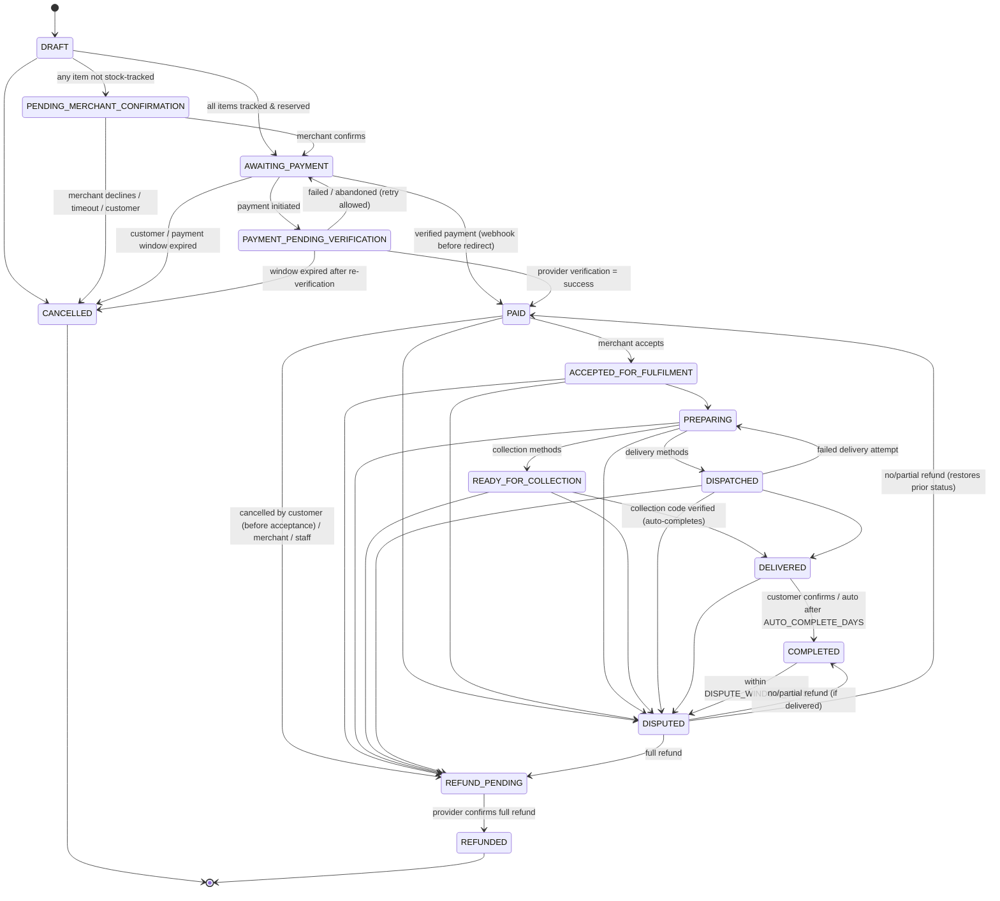

# Order state machine

Source of truth: [`apps/api/src/modules/orders/order-state-machine.ts`](../apps/api/src/modules/orders/order-state-machine.ts).
Every transition is a compare-and-set update plus an append-only `order_events` row (ADR 0005).

## Who may trigger each transition

| Transition                                              | Actor                                                 | Endpoint                                                       |
| ------------------------------------------------------- | ----------------------------------------------------- | -------------------------------------------------------------- | --------- | ----- | -------- | --------- | ---------- |
| → PENDING_MERCHANT_CONFIRMATION / AWAITING_PAYMENT      | system at checkout                                    | `POST /checkout/place`                                         |
| → AWAITING_PAYMENT (confirm)                            | merchant member                                       | `POST /merchant/:m/orders/:o/confirm`                          |
| → CANCELLED (decline)                                   | merchant member                                       | `…/reject`                                                     |
| → CANCELLED (unpaid)                                    | customer, staff, system (timeouts)                    | `POST /orders/:o/cancel`, `POST /admin/orders/:o/cancel`, jobs |
| → PAYMENT_PENDING_VERIFICATION                          | customer/guest                                        | `POST /orders/:o/pay`                                          |
| → PAID / → AWAITING_PAYMENT                             | provider verification only                            | webhook, `verify-payment`, reconciliation                      |
| → ACCEPTED / PREPARING / READY / DISPATCHED / DELIVERED | merchant member (staff for courier orders)            | `…/accept                                                      | preparing | ready | dispatch | delivered | collected` |
| DISPATCHED → PREPARING                                  | merchant / staff                                      | `…/delivery-failed`                                            |
| → COMPLETED                                             | customer, system (auto), collection code verification | `POST /orders/:o/confirm-receipt`                              |
| → REFUND_PENDING                                        | customer (PAID only), merchant MANAGER+, staff        | cancel endpoints, dispute resolution                           |
| → DISPUTED                                              | customer                                              | `POST /orders/:o/disputes`                                     |
| DISPUTED → \*                                           | SUPPORT staff                                         | `POST /admin/disputes/:d/resolve`                              |
| → REFUNDED                                              | provider refund success                               | refunds service                                                |

## Side effects

| On entering                    | Effects (same transaction)                                                                                                                   |
| ------------------------------ | -------------------------------------------------------------------------------------------------------------------------------------------- |
| order placed                   | checkout session (idempotency), price/merchant/terms snapshots, tracked stock reserved, merchant + customer notified                         |
| CANCELLED (unpaid)             | reservation released, open payment attempts abandoned, customer notified                                                                     |
| PAID                           | payment SUCCEEDED, stock committed, settlement allocation created, collection code issued, other attempts abandoned, notifications, audit    |
| DELIVERED via code / COMPLETED | settlement → ELIGIBLE                                                                                                                        |
| DISPUTED                       | settlement → ON_HOLD                                                                                                                         |
| REFUND_PENDING                 | refund raised for the remaining refundable balance (idempotency key `cancel:<order>` / `dispute:<id>`) and sent to the provider after commit |
| REFUNDED                       | settlement → REVERSED (or stays SETTLED with `refundedMinor` if already paid out)                                                            |

## Timers (jobs)

| Job                           | Default                              | Behaviour                                                                                |
| ----------------------------- | ------------------------------------ | ---------------------------------------------------------------------------------------- |
| `orders.expire_confirmations` | 24 h (`CONFIRMATION_WINDOW_MINUTES`) | cancel unconfirmed orders                                                                |
| `orders.expire_payments`      | 6 h (`PAYMENT_WINDOW_MINUTES`)       | re-verify open attempts with the provider, then cancel; late successes are auto-refunded |
| `orders.auto_complete`        | 3 days (`AUTO_COMPLETE_DAYS`)        | DELIVERED → COMPLETED                                                                    |
